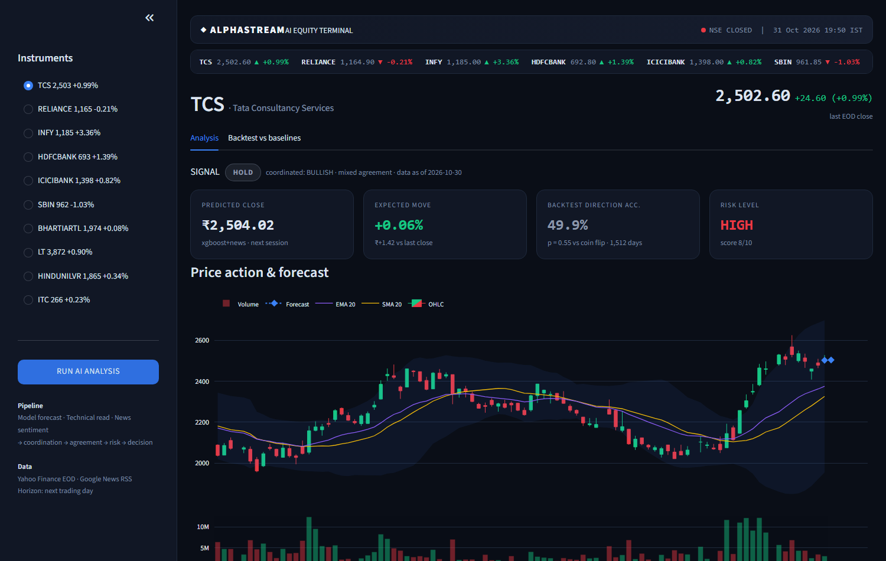
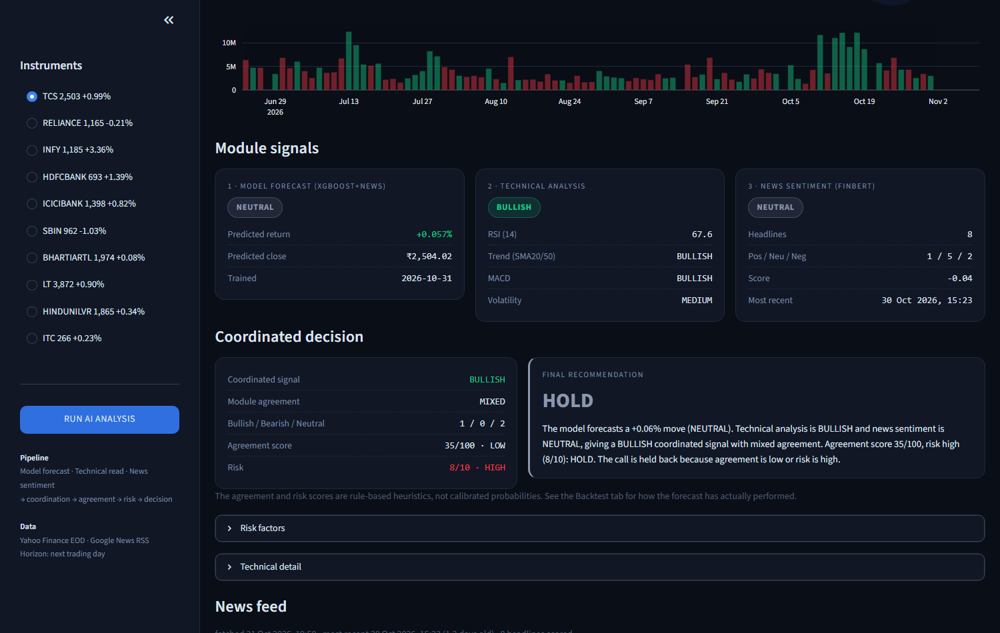
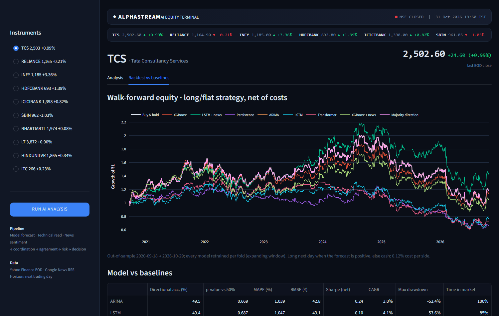
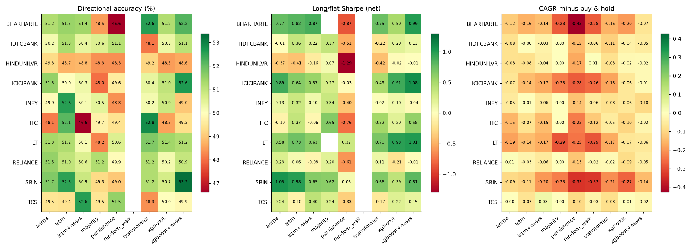
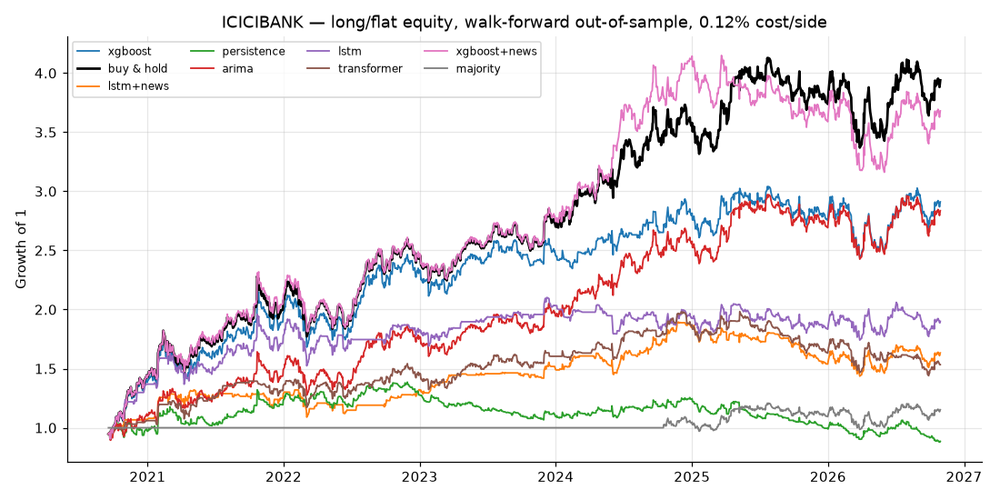
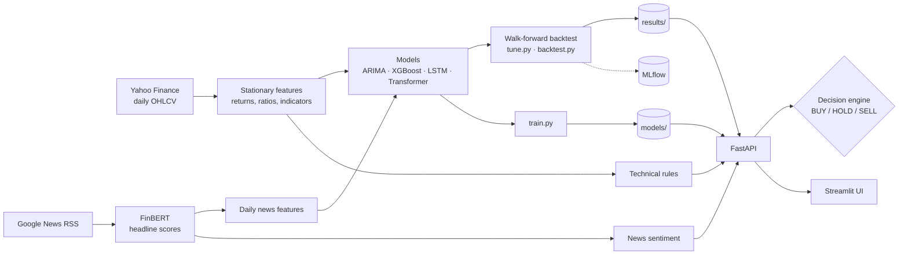

# AlphaStream: multi-module NSE stock forecasting

[](https://github.com/mohnish4code/Multi-Module-Stock-Prediction/actions/workflows/ci.yml)


Next-day forecasts for 10 NSE large caps (TCS, Reliance, Infosys, HDFC Bank, ICICI Bank, SBI, Bharti
Airtel, L&T, HUL, ITC), combining three signals:

1. **A forecasting model**: XGBoost on price/indicator features plus FinBERT news sentiment (chosen
   from ARIMA, XGBoost, LSTM and Transformer models by walk-forward backtest).
2. **Technical rules**: RSI, SMA trend, MACD and volatility.
3. **Live news sentiment**: Google News headlines scored with FinBERT.

A decision engine turns the three into BUY / HOLD / SELL. Everything is served through a FastAPI
service and a Streamlit terminal, and every model is evaluated with a leakage-free walk-forward
backtest against simple baselines.



<table>
  <tr>
    <td></td>
    <td></td>
  </tr>
  <tr>
    <td align="center">Module signals and the coordinated decision</td>
    <td align="center">Walk-forward equity curves and baseline comparison</td>
  </tr>
</table>

## Results

Walk-forward backtest, 6 one-year test folds per stock (Sep 2020 – Oct 2026, 1,512 trading days),
every model retrained on an expanding window before each fold. Strategy = hold the stock the next day
when the forecast is positive, otherwise cash, paying 0.12% per side. Averages over the 10 stocks:

| Model | Direction accuracy | Sharpe (net) | CAGR | Max drawdown | Stocks with p < 0.05 |
|---|---|---|---|---|---|
| Random walk (price baseline) | – | – | 0.0% | 0% | – |
| Majority direction | 49.4% | 0.35 | 4.0% | -28.5% | 0 / 10 |
| Persistence | 49.5% | -0.44 | -7.7% | -55.7% | 0 / 10 |
| ARIMA | 50.4% | 0.34 | 6.1% | -39.8% | 0 / 10 |
| XGBoost | 50.3% | 0.32 | 5.2% | -38.0% | 0 / 10 |
| LSTM | 51.0% | 0.38 | 6.1% | -34.3% | 2 / 10 |
| Transformer | 50.6% | 0.24 | 2.8% | -35.7% | 2 / 10 |
| **XGBoost + news** (served) | 50.8% | **0.47** | **8.9%** | -35.6% | 3 / 10 |
| LSTM + news | 50.2% | 0.31 | 4.4% | -35.5% | 1 / 10 |
| **Buy & hold** | – | **0.65** | **14.3%** | -33.8% | – |

What this shows:

- **No model has a reliable edge on next-day direction.** Accuracies sit at 49–51%; the few
  significant stock/model pairs are scattered, which is about what testing 80 pairs produces by chance.
- **Buy & hold wins** on both return and Sharpe in this rising market.
- **Price error is not skill.** Every model has MAPE ≈ 1.06%, and the random walk ("tomorrow = today")
  is the lowest at 1.060%.
- **News sentiment helps XGBoost a little** (better on 7 of 10 stocks, Wilcoxon p = 0.07–0.09) and
  hurts the LSTM.
- **Tuning did not transfer.** Optuna lowered validation error, but tuned XGBoost did slightly worse on
  the test years than the hand-set version.

The first version of this project looked better on paper; see [What changed in v2](#what-changed-in-v2)
for the bugs behind that.




More detail, including the news ablation and a check of easier targets (20-day direction, volatility
regime), is in [`notebooks/02_results_analysis.ipynb`](notebooks/02_results_analysis.ipynb). The data
itself is explored in [`notebooks/01_data_exploration.ipynb`](notebooks/01_data_exploration.ipynb).

## How the evaluation avoids leakage

- **Chronological, expanding-window folds** with a 5-row embargo between train, validation and test.
  A row's label is the next day's return, so without the gap the last training label would be the first
  test day's move.
- **Scalers and models are fit per fold on training rows only.** Indicators only use past prices; a test
  appends future bars and asserts that no past feature changes.
- **Hyperparameters are tuned on the first fold's validation block**, which ends before the first test day.
- **News**: a headline only affects trading days strictly after its publication date (IST), because
  older RSS timestamps are often date-only.
- **Sanity checks**: shuffling the target gives 49.9% accuracy; deliberately leaking the target gives
  96–100%, so the setup does catch leakage.

## Architecture



## Quick start

With Docker:

```bash
cp .env.example .env
python -m pip install -r requirements.txt   # once, to train the serving models locally
python train.py                             # ~1 min; or: docker compose run --rm api python train.py
docker compose up --build
```

- UI: http://localhost:8501
- API docs: http://localhost:8000/docs
- MLflow: http://localhost:5000

The API pre-runs every stock at startup (`WARMUP=1`), which takes about 3 minutes; after that a
prediction takes 1–3 s. Without warm-up the first request loads FinBERT and takes ~40 s.

Without Docker:

```bash
python -m venv venv && venv\Scripts\activate        # Windows (source venv/bin/activate elsewhere)
make install                                        # CPU torch + requirements-dev.txt
python train.py
make api        # terminal 1
make ui         # terminal 2
```

## Reproducing the results

```bash
python -m src.data.news                                    # backfill headlines (~1-3 h, resumable)
python tune.py --model xgboost --trials 60                 # also: lstm, transformer
python backtest.py                                         # all models, price features
python backtest.py --features news --models xgboost lstm   # news ablation
python backtest.py --replot                                # rescore and redraw from saved predictions
```

Price data is cached under `data/raw/` on the first run, so reruns give identical numbers. The
Transformer backtest is the slow part (a few hours on a 4-core CPU); running one process per group of
tickers with `TORCH_NUM_THREADS=1` is faster than one multi-threaded process.

## API

| Endpoint | Description |
|---|---|
| `GET /predict/{ticker}` | Forecast, technical read, news sentiment, decision and the last 90 bars. `?include_news=false` skips the news fetch. |
| `GET /backtest/{ticker}` | Walk-forward metrics per model and fold, and equity curves. |
| `GET /tickers` | Configured stocks and whether a trained model is available. |
| `GET /quotes` | Last close and day change for every stock. |
| `GET /health` | Model availability and data date (not rate limited). |

Unknown tickers return 404, missing models 503, invalid input 422; requests are rate limited per IP
(`RATE_LIMIT`, default 30/minute).

## Project structure

```
configs/          config.yaml (tickers, data, folds, costs, models), tuned.yaml (Optuna output)
src/
  data/           price download + parquet cache, Google News (live and backfill)
  features/       indicators, stationary model features, daily news features
  models/         Forecaster interface, baselines/ARIMA, XGBoost, PyTorch LSTM + Transformer
  evaluation/     walk-forward splits, metrics, backtest runner, plots
  signals/        technical rules, FinBERT/keyword sentiment, decision engine
  api/            FastAPI app and response schemas
  pipeline.py     analyse(): the one code path used by the API and the CLI
ui/               Streamlit app (talks to the API only)
notebooks/        data exploration and results analysis
docs/images/      screenshots used in this README
results/          metrics.csv, out-of-sample predictions, news features, plots
tests/            77 offline pytest tests
backtest.py  train.py  tune.py
```

## What changed in v2

v1 was a Keras LSTM per stock, scored on one 70/15/15 split, with keyword news sentiment and a
Streamlit dashboard. It reported ~1% MAPE and 45–51% direction accuracy. Rebuilding it found:

- **An evaluation bug**: the test set was rescaled with a freshly fitted scaler, and targets were
  inverted with a different scaler than the one that scaled them.
- **A one-day label leak** at every split boundary (now closed by the embargo).
- **A signal that never fired**: with a 1% "neutral" band, the LSTM's forecast was NEUTRAL on all
  15,120 backtest days. The band is now 0.10%, in line with the size of the forecasts.
- **Two decision paths**: the app and the CLI used different rules and could disagree; there is now
  one decision engine.

On top of the fixes, v2 adds the walk-forward backtest and baselines, XGBoost and a PyTorch
Transformer, the PyTorch port of the LSTM (checked against the Keras version before TensorFlow was
dropped), Optuna tuning, FinBERT features from ~63,600 backfilled headlines, MLflow tracking, the API,
Docker and CI.

## Limitations

- **Survivorship bias**: the 10 stocks are today's large caps, so buy & hold looks better than it
  would have for a list chosen in 2011.
- **News coverage** is thin before ~2016 and very uneven between stocks (ITC has only ~850 headlines
  because "ITC" alone matches too much unrelated news). Google News publication dates are not always
  precise.
- **FinBERT** misreads some phrasing ("loss narrows" scores as negative).
- **Costs** are a flat 0.12% per side; slippage and impact are ignored.
- **Daily close-to-close only**; no intraday data, no shorting.
- The agreement and risk scores in the decision engine are rule-based heuristics, not calibrated
  probabilities.
- yfinance is an unofficial data source and occasionally returns incomplete bars (these are dropped).

## Future work

- Longer horizons (5–20 days) and cross-sectional ranking of the 10 stocks instead of per-stock direction.
- Market-wide features: NIFTY returns, India VIX, FII/DII flows, USD/INR.
- One pooled model across stocks with a ticker embedding, which gives the neural models more data.
- Probability calibration so the decision engine can use real confidence instead of rule scores.

## Disclaimer

This is a research and learning project. Nothing here is investment advice.

## License

[MIT](LICENSE)
